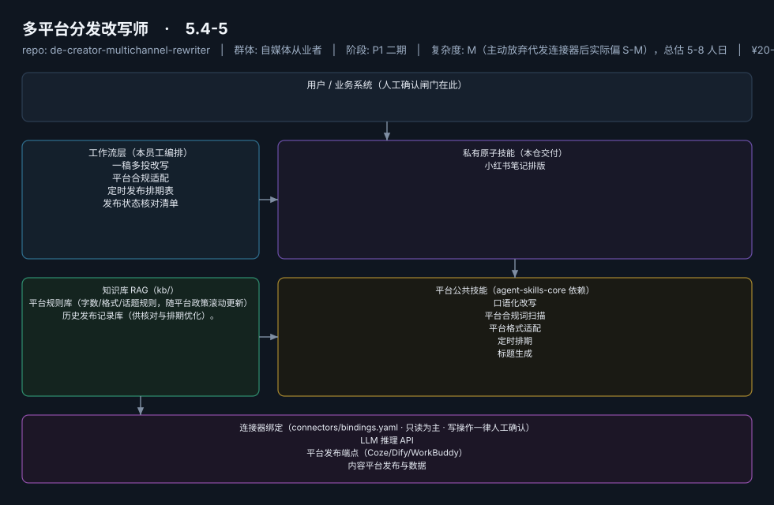
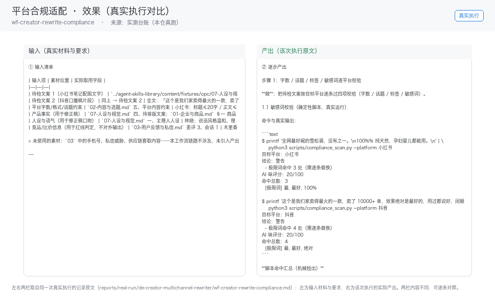

# 多平台分发改写师

> 一稿多投不是搬运，而是逐平台重写+合规适配的分发参谋
>
> **5.4-5**　·　自媒体从业者　·　阶段 P1 二期　·　
> 复杂度 M（主动放弃代发连接器后实际偏 S-M），总估 5-8 人日　·　¥20-50/月；**建议捆绑入组合包，不单独售卖**（面临蚁小二/易媒助手成熟竞争，据 R2 调研）　·　定义卡 5.4-5

## 演示（真实执行录播）


*真实执行回放（GIF 自动循环，非摆拍）· [▶ 观看完整版 MP4](workflows/wf-creator-rewrite-compliance/docs/images/08-demo-run.mp4) · 台账见 [`reports/real-run/wf-creator-rewrite-compliance.md`](reports/real-run/wf-creator-rewrite-compliance.md)*



## 效果（真实执行）



*上图为**真实效果对比**，不是示意图：左栏是输入材料与要求，右栏是该次执行的产出原文，
两栏取自同一次真实执行记录。*

- 完整台账：[`reports/real-run/wf-creator-rewrite-compliance.md`](reports/real-run/wf-creator-rewrite-compliance.md)
- 录屏与终端回放：[`workflows/wf-creator-rewrite-compliance/docs/images/`](workflows/wf-creator-rewrite-compliance/docs/images/)（`08-demo-run.gif` / `08-demo-run.mp4` / `04-terminal-run.png`）
- 使用示例：[`workflows/wf-creator-rewrite-compliance/docs/使用示例.md`](workflows/wf-creator-rewrite-compliance/docs/使用示例.md)
> 实测判定：**通过**　·　可用度 4/5　·　编造数字 0 处　·　红线命中 2 次 / 拦截 2 次


**一句话**：矩阵运营者与全平台创作者（日均 3h+ 耗在分发上的人群，据 R2 调研）

---

## 这个数字员工解决什么问题

一稿多投不是搬运，而是逐平台重写+合规适配的分发参谋

| 项 | 内容 |
|---|---|
| 服务对象 | 矩阵运营者与全平台创作者（日均 3h+ 耗在分发上的人群，据 R2 调研） |
| 可量化目标 | 分发环节耗时从 1-3h 压缩至 ≤30 分钟；逐平台合规校验覆盖率 100%；漏发/错发事故归零 |
| 投入产出 | 月省 30-60h 折 ¥900-1800，即便捆绑定价 ROI 仍 >10 倍 |
| 需求依据 | D11、D26 |
| 分发渠道 | GitHub（必备基础渠道）、小红书、Coze扣子商店、Dify Marketplace、豆包工作 |

## 30 秒上手

```bash
git clone <本仓库地址> && cd de-creator-multichannel-rewriter
pip install pyyaml
python3 tests/run.py            # 先跑一遍自检，确认环境与契约都对得上
```

试用（把 `<输入>` 换成本人真实材料）：

```text
请以「多平台分发改写师」的身份，帮我跑「一稿多投改写」。
材料如下：<输入>
要求：只使用材料里出现过的数字，缺的写 <待填>；对外文案停在待确认状态。
```

详细接入见 [`docs/01-安装与接入.md`](docs/01-安装与接入.md)。

## 仓库结构

```text
de-creator-multichannel-rewriter/
├── employee.md            # 人读定义卡（12 主字段 + 2 扩展组，由 employee.yaml 生成）
├── employee.yaml          # 机器契约（能力清单 + 依赖锁）
├── dependencies.yaml      # 对 core 的外部依赖（含版本）
├── persona/               # 运行提示词 / 边界 / KPI
├── skills/                # 私有原子技能（1 个）
├── spec-bindings/         # 有意不公共化能力的本地绑定声明（0 个）
├── workflows/             # 本员工工作流（4 条）
├── kb/                    # 知识库 RAG 契约
├── connectors/            # 连接器绑定（只读为主，写操作人工确认）
├── docs/                  # 六类发布文档
└── tests/                 # 自动化多场景测试
```

## 私有原子技能（1）

| 技能 | slug | 复杂度 | 阶段 | 成熟度 |
|---|---|---|---|---|
| `小红书笔记排版` | `xhs-note-layout` | S | P1 | 契约完备 |

## 平台公共技能依赖（5）

| 技能 | slug | 全平台复用员工数 |
|---|---|---|
| `口语化改写` | `colloquial-rewrite` | 2 |
| `平台合规词扫描` | `compliance-word-scan` | 6 |
| `平台格式适配` | `platform-format-adapter` | 6 |
| `定时排期` | `scheduled-dispatch` | 6 |
| `标题生成` | `title-generator` | 4 |

> 这些技能来自 `agent-skills-core@1.0.0`，本仓库**只引用不复制**。

## Spec 绑定层（0）

（无）

> 这一族能力**有意不公共化**（与外部平台接口强绑定）。本仓不存正文，
> 只留本地绑定声明与连接器配置。

## 工作流（4）

| 工作流 | slug | 触发 | 阶段 | 调用技能数 |
|---|---|---|---|---|
| `一稿多投改写` | `wf-creator-rewrite-style` | 人工（成稿后） | P1 | 3 |
| `平台合规适配` | `wf-creator-rewrite-compliance` | 事件（WF1 后自动） | P1 | 2 |
| `定时发布排期表` | `wf-creator-rewrite-schedule` | 定时（每周） | P1 | 1 |
| `发布状态核对清单` | `wf-creator-rewrite-publish-check` | 定时（每日收尾） | P1 | 1 |

## 知识库与连接器

- 知识库语料：['平台规则库（字数/格式/话题规则，随平台政策滚动更新）', '历史发布记录库（供核对与排期优化）。']
- 连接器：LLM 推理 API、平台发布端点（Coze/Dify/WorkBuddy）、内容平台发布与数据

## 质量与验收

| 项 | 值 |
|---|---|
| 技能文件数 | 73 |
| 多场景用例数 | 167 |
| 用例通过 | 167 |
| 验收结论 | ✅ 通过 |

完整报告：[`docs/05-验收与测试.md`](docs/05-验收与测试.md)

## 许可

专有许可，详见 [`LICENSE`](LICENSE)。
