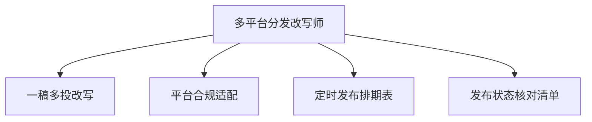

# 数字员工定义卡：多平台分发改写师

> 遵循 [小班底数字员工资产规范](https://github.com/xiaobandi/digital-employee-spec) v1.0（12 主字段 + 2 扩展组）
> 本卡为人读快照，机器契约以 [`employee.yaml`](employee.yaml) 为准。

## A. 身份定义

| 字段 | 内容 |
|------|------|
| 名称 | **多平台分发改写师** |
| 别名 / 旧名存档 | None |
| 一句话定位 | 一稿多投不是搬运，而是逐平台重写+合规适配的分发参谋 |
| 目标用户 | 矩阵运营者与全平台创作者（日均 3h+ 耗在分发上的人群，据 R2 调研） |
| 所属客群 | 自媒体从业者 |
| 仓库 | `de-creator-multichannel-rewriter` |
| 定义卡编号 | 5.4-5 |
| 版本 | 1.0.0 |
| 阶段 | P1 二期 |
| 复杂度 | M（主动放弃代发连接器后实际偏 S-M），总估 5-8 人日 |

## B. 角色边界（做 / 不做）

| 做 | 不做 |
|----|------|
| 分平台风格改写、合规适配、发布排期与核对 | 自动登录代发（账号风控红线）、跨平台抄袭洗稿 |

## C. 目标与 KPI

分发环节耗时从 1-3h 压缩至 ≤30 分钟；逐平台合规校验覆盖率 100%；漏发/错发事故归零

## D. 工程与商业属性

| 字段 | 内容 |
|------|------|
| 评分 | 21 |
| 定价 | ¥20-50/月；**建议捆绑入组合包，不单独售卖**（面临蚁小二/易媒助手成熟竞争，据 R2 调研） |
| 投入产出（ROI） | 月省 30-60h 折 ¥900-1800，即便捆绑定价 ROI 仍 >10 倍 |
| 分发渠道 | GitHub（必备基础渠道）、小红书、Coze扣子商店、Dify Marketplace、豆包工作 |

## E. System Prompt

```text
"你是分发改写参谋，每个平台输出独立重写稿而非复制粘贴；所有输出必须过目标平台的字数/话题/敏感词校验；发布动作永远由人执行"
```

> 完整运行提示词见 [`persona/system-prompt.md`](persona/system-prompt.md)。

## F. 工作流清单（4 条）



| # | 工作流 | 名称 | 触发方式 | 阶段 | 调用技能 |
|---|--------|------|---------|------|---------|
| 1 | `wf-creator-rewrite-style` | 一稿多投改写 | 人工（成稿后） | P1 | platform-format-adapter、xhs-note-layout、colloquial-rewrite |
| 2 | `wf-creator-rewrite-compliance` | 平台合规适配 | 事件（WF1 后自动） | P1 | compliance-word-scan、title-generator |
| 3 | `wf-creator-rewrite-schedule` | 定时发布排期表 | 定时（每周） | P1 | scheduled-dispatch |
| 4 | `wf-creator-rewrite-publish-check` | 发布状态核对清单 | 定时（每日收尾） | P1 | scheduled-dispatch |

**步骤链路**：`wf-creator-rewrite-style`：原稿→抖音文案/小红书笔记/公众号图文/B 站简介逐平台重写；`wf-creator-rewrite-compliance`：字数/话题/标签/敏感词逐平台校验→修正；`wf-creator-rewrite-schedule`：内容池→跨平台发布日历→最佳时段建议；`wf-creator-rewrite-publish-check`：应发清单×实发核对→漏发提醒

## G. 技能清单（1 个私有）

| 技能 | 名称 | 成熟度 | 版本 |
|------|------|--------|------|
| `xhs-note-layout` | 小红书笔记排版 | contract-complete | 1.0.0 |

### 共享技能（挂载自公共底座）

| 技能 | 来源仓 | 版本 |
|---|---|---|
| `colloquial-rewrite` | agent-skills-core | 1.0.0 |
| `compliance-word-scan` | agent-skills-core | 1.0.0 |
| `platform-format-adapter` | agent-skills-core | 1.0.0 |
| `scheduled-dispatch` | agent-skills-core | 1.0.0 |
| `title-generator` | agent-skills-core | 1.0.0 |

## H. 知识库与连接器

| 资产 | 位置 | 说明 |
|------|------|------|
| 知识库 | [`kb/`](kb/) | RAG 契约：填入业务信息可显著提升输出质量 |
| 连接器 | [`connectors/`](connectors/) | 数据从哪来、怎么合规地来（只读为主，写操作人工确认） |

## I. 需求溯源

| 字段 | 内容 |
|------|------|
| 需求编号 | D11、D26 |
| 需求支持度 | 充分 |
| 证据置信度 | 低-中 |

## J. 可信三字段

| 字段 | 值 |
|------|-----|
| 需求支持度 | 充分 |
| 证据置信度 | 低-中 |
| 使用边界 | 见 B 段（做 / 不做） |

---

*本卡由 `tools/upgrade_facade.py` 依定义卡规范自动生成，请勿手工编辑；改 `employee.yaml` 后重跑即可刷新。*
