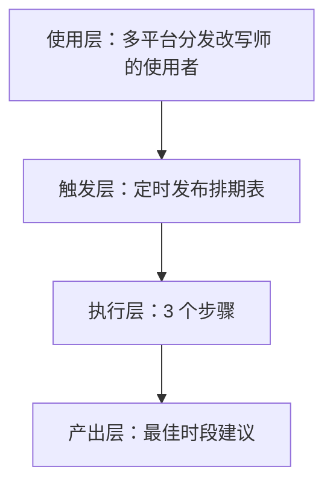
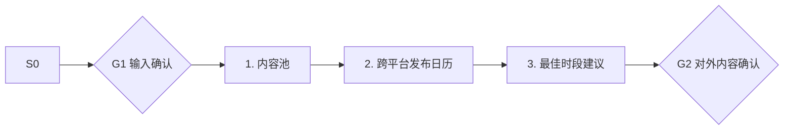

# 定时发布排期表 · 架构与流程图

## 本工作流的四层结构

| 层 | 内容 |
|---|---|
| 使用层 | 矩阵运营者与全平台创作者（日均 3h+ 耗在分发上的人群，据 R2 调研）；员工定位：一稿多投不是搬运，而是逐平台重写+合规适配的分发参谋 |
| 触发层 | 关键词 / 显式点名「定时发布排期表」；触发方式：定时（每周） |
| 执行层 | 内容池 → 跨平台发布日历 → 最佳时段建议 |
| 产出层 | 最佳时段建议 |

## 执行流程

## 步骤职责表

| # | 步骤 | 承担者 | 为什么 |
|---|---|---|---|
| 1 | 内容池 | 模型 | 需要读懂语境，不可用固定规则替代 |
| 2 | 跨平台发布日历 | 模型 | 需要读懂语境，不可用固定规则替代 |
| 3 | 最佳时段建议 | 模型 | 需要读懂语境，不可用固定规则替代 |

⚠️ 尚未补齐：图中的步骤来自注册表口径，未逐条实跑校验；实跑后请同步修订本页（`发布标准.md` 第六项：通读一遍，不得出现重复填充句）。
